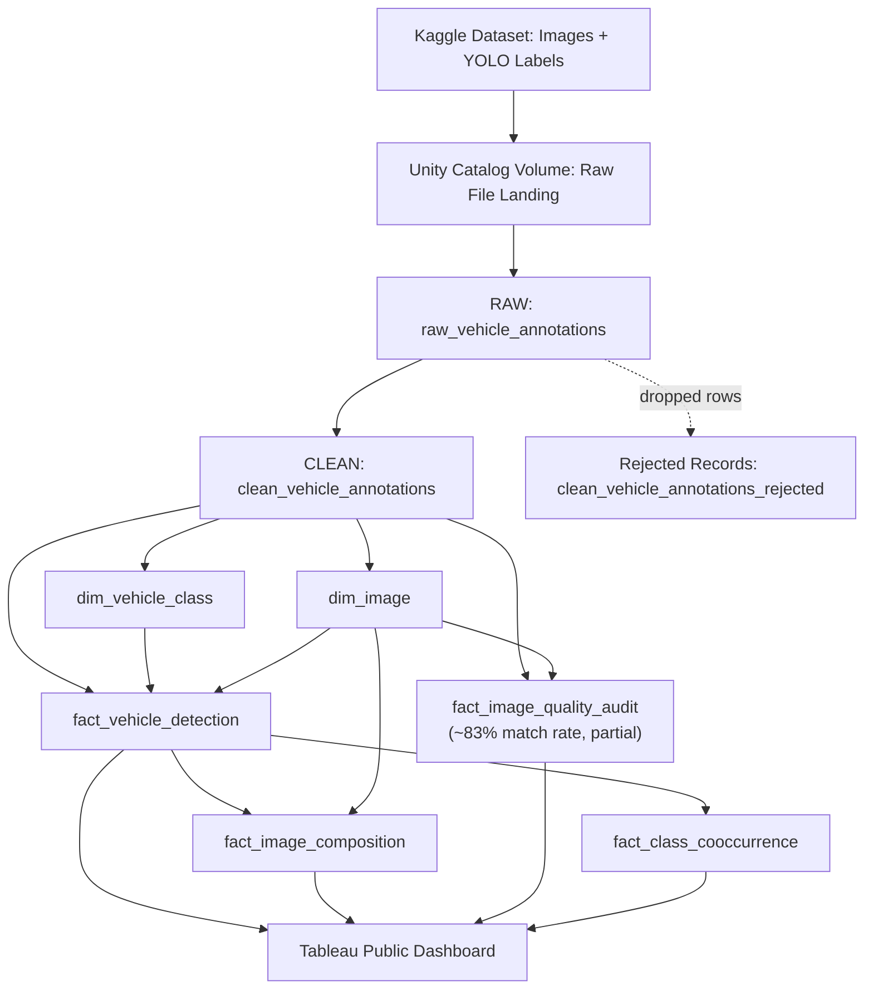

# Vehicle Composition in a Philippine Road Image Dataset

A data pipeline and analytics dashboard that uses 50,842 labeled vehicle detections (across 31,367 images) from a DLSU-D vehicle detection dataset to evaluate findings about vehicle composition, road space usage, and vehicle co-occurrence patterns within the dataset, built on Databricks Free Edition using a medallion architecture and a fact constellation schema.
---

## About the Project

Existing work on this dataset (a DLSU-D thesis project) focuses entirely on model performance, mAP scores, precision, recall, confusion matrices. What hasn't been explored is what the labeled data itself says about real Philippine road traffic.

Using the confirmed annotation data (vehicle class and bounding box per detection, across 37,556 images), it wants to determine the following:

- What does the actual vehicle mix on Philippine roads look like, by volume?
- Which vehicle types dominate physical road space, regardless of how frequently they appear?
- Which vehicle types tend to appear together in the same scene?
- Do Philippine-specific vehicle types (jeepney, tricycle) show up in more cluttered, multi-vehicle scenes than standard classes?
- Does image label quality (per the dataset's own CleanLab audit) relate to how visually cluttered a scene is?

---

## Data Source

[Philippine Vehicle Classification and Detection Dataset (14 Classes), CleanLab Cleaned](https://www.kaggle.com/datasets/jancarloparedes/philippine-vehicle-classification-14class), originally a DLSU-D thesis project, 37,556 labeled images across 14 vehicle classes, YOLO format annotations, CC BY 4.0 licensed.


---

## Tools & Technologies Used

- **Databricks Free Edition** for compute, storage, and orchestration, no credit card required
- **Unity Catalog** for schema and volume management
- **Lakeflow Declarative Pipelines (SQL)** for the raw-to-clean transformation, with declarative data quality constraints
- **SQL Warehouses** for the mart layer build and analysis queries
- **Tableau Public** for the final dashboard

---

## Concepts Demonstrated

- **Medallion Architecture**: raw, clean, and mart layers
- **Declarative Data Quality Checks**: constraint-based validation inside the pipeline itself, not bolted-on manual scripts
- **Fact Constellation Schema**: multiple fact tables at different grains (detection level, image level, audit level)
- **Analytical SQL**: business questions answered through aggregation, self-joins, and multi-table joins

---

## Architecture Diagram



---

## Pipeline Layers

### 1. Raw Layer

Lands YOLO annotation data exactly as received, no filtering, with lineage columns for traceability.

```sql
create catalog if not exists vehicle_project;
create schema if not exists vehicle_project.bronze;
create schema if not exists vehicle_project.silver;
create schema if not exists vehicle_project.gold;
create volume if not exists vehicle_project.bronze.raw_files;
```

```sql
create or refresh streaming table vehicle_project.bronze.raw_vehicle_annotations
as
select
  filename,
  class_id,
  x_center,
  y_center,
  width,
  height,
  split,
  _metadata.file_path as _source_file,
  current_timestamp() as _ingested_at
from stream read_files(
  '/Volumes/vehicle_project/bronze/raw_files/annotations',
  format => 'csv'
);
```

**Table: `raw_vehicle_annotations`**

| column | type | notes |
|---|---|---|
| filename | string | unvalidated |
| class_id | int | unvalidated, may be out of range |
| x_center, y_center, width, height | float | unvalidated |
| split | string | train, valid, or test |
| _source_file | string | lineage |
| _ingested_at | timestamp | load time |

### 2. Clean Layer, With Declarative Data Quality (DLQ) Checks

Validation is expressed as `constraint ... expect` clauses directly in the SQL table definition. Built as a **materialized view** rather than a streaming table, since deduplication requires a `row_number()` window function that looks across the whole dataset, something streaming tables can't do since they process incrementally. Rows failing a constraint are dropped, and their counts are automatically tracked in the pipeline's built-in data quality metrics view. A companion table separately captures what was rejected, for transparency.

```sql
/**
Version 1.3.0
Desc: validates, dedupes, and stages the annotation data in silver, single step
created by CPJ on 9/16/2026
**/

create or refresh materialized view vehicle_project.silver.clean_vehicle_annotations
(
    -- Implement null check and range check
    constraint has_filename expect (filename is not null) on violation drop row,
    constraint valid_class_id expect (class_id is not null and class_id between 0 and 13) on violation drop row,
    constraint valid_split expect (split in ('train', 'valid', 'test')) on violation drop row,
    constraint valid_bbox_coords expect (
        x_center is not null and x_center between 0 and 1 and
        y_center is not null and y_center between 0 and 1 and
        width is not null and width between 0 and 1 and
        height is not null and height between 0 and 1
    ) on violation drop row,
    constraint nonzero_bbox_area expect (width > 0 and height > 0) on violation drop row,
    -- Check if box is within frame
    constraint bbox_within_frame expect (
        x_center - width / 2 >= 0 and
        x_center + width / 2 <= 1 and
        y_center - height / 2 >= 0 and
        y_center + height / 2 <= 1
    ) on violation drop row
)
as
-- Dedup: keep only the first occurrence of each exact duplicate detection
select * except (row_num)
from (
    select
        filename, class_id, x_center, y_center, width, height, split, _ingested_at,
        row_number() over (
            partition by filename, class_id, x_center, y_center, width, height
            order by _ingested_at
        ) as row_num
    from vehicle_project.bronze.raw_vehicle_annotations
)
where row_num = 1;
```

**Table: `clean_vehicle_annotations`**

| column | type | notes |
|---|---|---|
| filename | string | validated |
| class_id | int | validated 0 to 13 |
| x_center, y_center, width, height | float | validated within 0 to 1, nonzero area, box within frame |
| split | string | validated against train/valid/test |
| _ingested_at | timestamp | carried from raw |

**Rejected records table**, capturing missing fields, invalid values, and exact duplicates, all in one place for transparency:

```sql
/**
Version 1.1.0
Desc: captures rejected annotation rows (missing, invalid, or duplicate) for transparency
created by CPJ on 9/16/2026
**/

create or refresh materialized view vehicle_project.silver.clean_vehicle_annotations_rejected
as
select
    *,
    -- Missing records
    case
        when filename is null then 'missing_filename'
        when class_id is null then 'missing_class_id'
        when x_center is null then 'missing_x_center'
        when y_center is null then 'missing_y_center'
        when width is null then 'missing_width'
        when height is null then 'missing_height'
        else null
    end as missing,

    -- Invalid records
    case
        when class_id not between 0 and 13 then 'invalid_class_id'
        when split not in ('train', 'valid', 'test') then 'invalid_split'
        when x_center not between 0 and 1 then 'invalid_x_center'
        when y_center not between 0 and 1 then 'invalid_y_center'
        when width not between 0 and 1 then 'invalid_width'
        when height not between 0 and 1 then 'invalid_height'
        when width <= 0 or height <= 0 then 'invalid_bbox_area'
        when x_center - width / 2 < 0 or x_center + width / 2 > 1 then 'invalid_bbox_x'
        when y_center - height / 2 < 0 or y_center + height / 2 > 1 then 'invalid_bbox_y'
        else null
    end as invalid_bbox,

    -- Duplicate records, exact match on all detection fields
    case
        when row_number() over (
            partition by filename, class_id, x_center, y_center, width, height
            order by _ingested_at
        ) > 1 then 'duplicate_detection'
        else null
    end as duplicate_reason

from vehicle_project.bronze.raw_vehicle_annotations
where missing is not null or invalid_bbox is not null or duplicate_reason is not null;
```

**Confirmed duplicate check result:** running an exact-match count against the raw layer surfaced 1 duplicate group out of 50,843 raw annotation rows (`IMG_3694_JPG.rf.5c993b89b7b3412e4d94716644434b9b.jpg`, class_id 0, duplicated twice).

### 3. Mart Layer (Gold), Fact Constellation Schema

Built as plain SQL tables through a SQL warehouse, since the Lakeflow pipeline slot is used by the raw and clean layers (Free Edition allows one active pipeline per type).

**Dimension: `dim_vehicle_class`**

```sql
create or replace table vehicle_project.gold.dim_vehicle_class as
select * from (values
  (0, 'Bicycle', 2, 'non-motorized', false),
  (1, 'Electric Bike', 2, 'private', false),
  (2, 'Hatchback', 4, 'private', false),
  (3, 'Large Bus', 4, 'public transport', false),
  (4, 'Light Goods Vehicle', 4, 'goods/freight', false),
  (5, 'Medium Goods Vehicle', 4, 'goods/freight', false),
  (6, 'Motorcycle', 2, 'private', false),
  (7, 'Pickup Truck', 4, 'private', false),
  (8, 'Public Utility Jeepney', 4, 'public transport', true),
  (9, 'Sedan', 4, 'private', false),
  (10, 'Small Bus', 4, 'public transport', false),
  (11, 'Sports Utility Vehicle', 4, 'private', false),
  (12, 'Tricycle', 3, 'public transport', true),
  (13, 'Van', 4, 'private', false)
) as t(class_id, class_name, wheel_count, vehicle_category, is_ph_specific);
```

**Dimension: `dim_image`**

```sql
create or replace table vehicle_project.gold.dim_image as
select
  filename as image_id,
  filename,
  split,
  640 as image_width_px,
  640 as image_height_px
from (select distinct filename, split from vehicle_project.silver.clean_vehicle_annotations);
```

**Fact: `fact_vehicle_detection`** (grain: one row per detected vehicle)

```sql
create or replace table vehicle_project.gold.fact_vehicle_detection as
select
  concat(c.filename, '_', cast(row_number() over (partition by c.filename order by c.x_center) as string)) as detection_id,
  i.image_id,
  c.class_id,
  c.x_center,
  c.y_center,
  c.width,
  c.height,
  c.width * c.height as bbox_area
from vehicle_project.silver.clean_vehicle_annotations c
join vehicle_project.gold.dim_image i on c.filename = i.filename;
```

**Fact: `fact_image_composition`** (grain: one row per image)

```sql
create or replace table vehicle_project.gold.fact_image_composition as
select
  image_id,
  count(*) as total_vehicle_count,
  count(distinct class_id) as distinct_class_count,
  max_by(class_id, bbox_area) as dominant_class_id
from vehicle_project.gold.fact_vehicle_detection
group by image_id;
```

**Fact: `fact_image_quality_audit`** (grain: one row per audited image, train and valid only)

```sql
create or replace table vehicle_project.gold.fact_image_quality_audit (
  image_id string,
  cleanlab_quality_score float,
  was_quarantined boolean
);
-- populated from cleanlab_audit/audit_results_train.csv and audit_results_valid.csv
-- uploaded to a Unity Catalog Volume and loaded via a separate ingestion step
```

**Fact: `fact_class_cooccurrence`** (grain: one row per co-occurring class pair, per image)

```sql
create or replace table vehicle_project.gold.fact_class_cooccurrence as
select
  a.image_id,
  a.class_id as class_id_a,
  b.class_id as class_id_b
from vehicle_project.gold.fact_vehicle_detection a
join vehicle_project.gold.fact_vehicle_detection b
  on a.image_id = b.image_id
  and a.class_id < b.class_id;
```

---

## Analysis Queries (What the Dashboard Answers)

**1. Actual vehicle mix on Philippine roads**

```sql
select d.class_name, count(*) as detection_count
from fact_vehicle_detection f
join dim_vehicle_class d on f.class_id = d.class_id
group by d.class_name
order by detection_count desc;
```

**2. Road space dominance vs frequency**

```sql
select d.class_name, count(*) as detection_count, avg(f.bbox_area) as avg_bbox_area
from fact_vehicle_detection f
join dim_vehicle_class d on f.class_id = d.class_id
group by d.class_name
order by avg_bbox_area desc;
```

**3. Vehicle type co-occurrence**

```sql
select da.class_name as class_a, db.class_name as class_b, count(*) as cooccurrence_count
from fact_class_cooccurrence c
join dim_vehicle_class da on c.class_id_a = da.class_id
join dim_vehicle_class db on c.class_id_b = db.class_id
group by da.class_name, db.class_name
order by cooccurrence_count desc;
```

**4. Do PH-specific vehicles appear in more cluttered scenes? — WRITTEN, NOT YET RUN**

```sql
select d.is_ph_specific, avg(comp.total_vehicle_count) as avg_vehicles_in_scene, avg(comp.distinct_class_count) as avg_class_diversity
from fact_vehicle_detection f
join dim_vehicle_class d on f.class_id = d.class_id
join fact_image_composition comp on f.image_id = comp.image_id
group by d.is_ph_specific;
```

**5. Image quality vs scene clutter — DROPPED, see Known Constraints**

This finding required joining `fact_image_quality_audit` (from the CleanLab audit CSVs) to `fact_image_composition`. Verification showed this join is unreliable, see Known Constraints below for the confirmed reason.

---

## How to Use the Dashboard

https://dbc-160be497-0e81.cloud.databricks.com/dashboardsv3/01f1b3fe614b12cc881f4f16164d3532/published?o=7474655651129263&f_6f5ef1b5%7Ea5ea8c83=_all_ 

**One global filter** sits at the top: **Vehicle Category** (private / public transport / goods-freight / non-motorized), narrows the whole dashboard to one category at a time.

**KPI row**, four numbers that respond to the filter: Total detections, Share of all vehicles, Average % of photo frame occupied, and Number of vehicle types in the selected category.

**Reading order, top to bottom:**
1. **Vehicle mix** - which vehicle types show up most often (the headline chart)
2. **Private vs public** and **Two vs four wheels** — two quick composition breakdowns, side by side
3. **How much of the photo does each vehicle fill?** — road space per vehicle type, meant to be read against the vehicle mix chart above it (common but small, or rare but large?)
4. **Jeepney vs tricycle** and **Freight mix** — two focused, PH-specific and freight-specific comparisons, side by side
5. **Which types pair up?** (heatmap) and **Travels in groups?** (bar chart) — both answer "what happens inside one photo," paired since they're two sides of the same question. Note: the Large Bus result in "Travels in groups?" is driven by a small number of depot-style photos, shown as a caption directly on the chart, not hidden in a separate notes section.
6. **Scene complexity** and **Rarest types** — footer, dataset context rather than headline findings.

Query numbers for every widget are documented in `05_analysis/analysis_queries.sql`, each SQL block states which dashboard card it feeds.

---

## Pipeline Verification Results (Confirmed, as of 9/16/2026)

Results from running the bronze and silver layers in Databricks Free Edition, not projected or assumed:

| Table | Row Count | Notes |
|---|---|---|
| `raw_vehicle_annotations` | 50,843 | Landed successfully via Auto Loader, streaming table |
| `clean_vehicle_annotations` | 50,842 | Materialized view, validation + dedup applied |
| `clean_vehicle_annotations_rejected` | 1 (expected) | The single confirmed exact duplicate |

**Cross-check against the dataset's own official documentation:** the source dataset ships a `labels.jpg` chart showing per-class instance counts for the training split. Summing all 14 bars from that chart gives exactly 44,142, matching this project's own independently computed `train` split detection count (44,142, see "50,843 vs distinct images" section below) exactly. This confirms the ingestion pipeline correctly reproduces the same per-image annotation counts as the dataset's own official training report, no drift introduced during bronze/silver processing.

**Data quality expectations, per the pipeline's native Expectations view:**

| Constraint | Action | Fail % | Failed Records |
|---|---|---|---|
| `bbox_within_frame` | DROP | 0% | 0 |
| `has_filename` | DROP | 0% | 0 |
| `nonzero_bbox_area` | DROP | 0% | 0 |
| `valid_bbox_coords` | DROP | 0% | 0 |
| `valid_class_id` | DROP | 0% | 0 |
| `valid_split` | DROP | 0% | 0 |

**Finding:** zero rows failed any of the six declarative validation constraints. The entire 1-row reduction from raw to clean (50,843 → 50,842) is fully explained by the single confirmed exact-duplicate detection, not by any data quality violation. This is consistent with the dataset already having gone through a CleanLab audit prior to release, the source data was genuinely clean going in.

---

## Lessons Learned: Pipeline and Git Setup

A few real issues hit while building this, documented here since they're common enough to be worth flagging for anyone reworking this pattern:

- **SQL Editor "Query" objects are not valid pipeline source files.** Running `create or refresh` statements directly in the SQL Editor (rather than as a `.sql` file inside the pipeline's source folder) creates a hidden, auto-managed pipeline per table, and that table can't then be claimed by your actual named pipeline (`TABLE_ALREADY_MANAGED_BY_OTHER_PIPELINE`). Always create pipeline SQL as a plain **File**, not a Query, inside the Git Folder.
- **After manually dropping a materialized view's table**, a stale internal staging reference can cause `TABLE_DOES_NOT_EXIST: Staging Table '...' does not exist` on the next run. Fixed with a Full Refresh on the affected table(s), not just a normal pipeline run.
---

## Known Constraints

- Databricks Free Edition allows one active Lakeflow Declarative Pipeline per type, raw and clean share a single pipeline, mart is built separately via SQL warehouse
